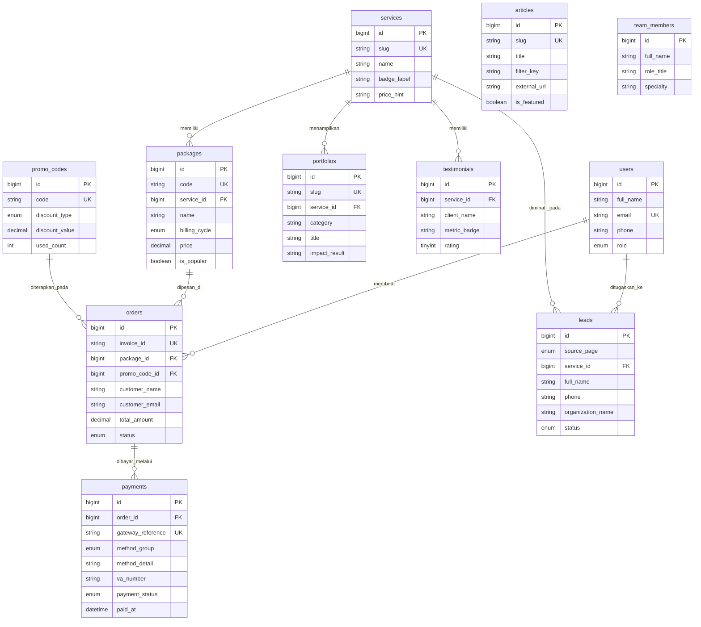

# Struktur Database DigiCreative (`digicreative_db`)

Skema database relasional (MySQL 8.0+ / MariaDB 10.6+) yang mendukung seluruh fitur website **DigiCreative** (`kelasdigi.id`), mulai dari katalog layanan, paket harga, kode promo, transaksi *payment gateway*, formulir *leads*, artikel, portofolio, hingga profil tim.

## Entity Relationship Diagram (ERD)



## Ringkasan 11 Tabel
| No | Tabel | Fungsi |
|---|---|---|
| 1 | `users` | Akun admin, konsultan, dan customer. |
| 2 | `services` | 6 layanan utama DigiCreative (Social Media, Web Dev, Graphic Design, Goes to Campus, In House Training, DiGi Potrait). |
| 3 | `packages` | 14 paket harga berbayar yang terhubung ke masing-masing layanan. |
| 4 | `promo_codes` | Kode promo (`DIGI10`, `KELASDIGI`) dengan tipe diskon persen/nominal. |
| 5 | `orders` | Pesanan paket beserta invoice, rincian subtotal/diskon/admin fee, dan status. |
| 6 | `payments` | Detail pembayaran gateway (QRIS, Virtual Account, E-Wallet, Kartu) & log webhook. |
| 7 | `leads` | Semua pengajuan form dari Beranda, Kontak, Kampus, In-House Training, dan DiGi Potrait. |
| 8 | `articles` | Daftar artikel edukasi & URL redirect ke website sumber aslinya. |
| 9 | `portfolios` | Portofolio karya desain & proyek klien dengan kategori filter. |
| 10 | `team_members` | 8 profil tim ahli pada halaman Profil Perusahaan. |
| 11 | `testimonials` | Testimoni klien per layanan lengkap dengan badge metrik. |

## Cara Import ke MySQL / phpMyAdmin (XAMPP / Laragon)
1. Buka **phpMyAdmin** atau terminal MySQL.
2. Import file `database/schema.sql` terlebih dahulu untuk membuat database `digicreative_db` dan seluruh tabelnya.
3. Import file `database/seed.sql` untuk mengisi data awal yang identik dengan website.

Atau via CLI:
```bash
mysql -u root -p < database/schema.sql
mysql -u root -p < database/seed.sql
```
